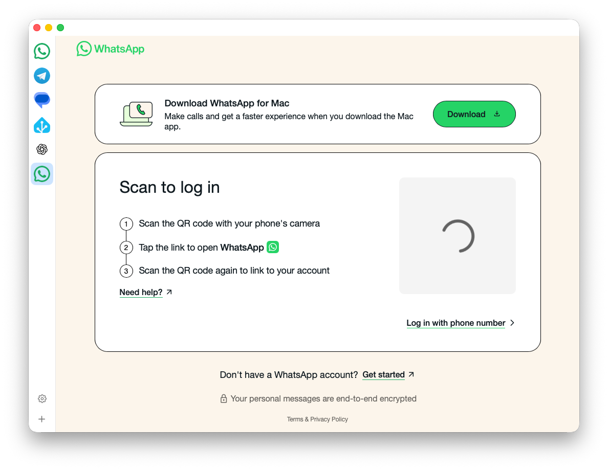

<p align="center">
  
</p>

<h1 align="center">WebMux</h1>

<p align="center">
  All your web apps in one native macOS window.<br>
  <em>~5 MB · No Electron · Persistent sessions</em>
</p>

<p align="center">
  
  
  <a href="LICENSE"></a>
</p>

---

WebMux is a lightweight native alternative to [Ferdium](https://ferdium.org) / Franz / Rambox. It aggregates web services (WhatsApp, Telegram, Slack, etc.) into a single sidebar-driven window using the system WebKit engine — no bundled browser, no Electron overhead.

Each service runs in its own isolated webview with persistent cookies and storage, so you stay logged in across restarts.

<p align="center"></p>

## Install

Download the latest `.zip` from [Releases](https://github.com/Izikd/WebMux/releases), extract `WebMux.app`, and drag it to `/Applications`.

> **Note:** WebMux is not notarized with Apple, so macOS will block the first launch. To allow it:
> 1. Open the app (macOS will show a warning — click **Done**)
> 2. Go to **System Settings → Privacy & Security**
> 3. Click **Open Anyway** next to the WebMux message
>
> You only need to do this once. Alternatively, run `xattr -cr WebMux.app` in Terminal before opening.

## Build from Source

```bash
git clone git@github.com:Izikd/WebMux.git
cd WebMux
./build.sh run
```

Requires macOS 14 (Sonoma)+ and Swift 6.0+ (included with Xcode 16 or Command Line Tools).

## Build Commands

| Command | Description |
|---|---|
| `./build.sh build` | Debug build |
| `./build.sh release` | Optimized release build |
| `./build.sh run` | Build + bundle + launch |
| `./build.sh bundle` | Build + create `.app` bundle |
| `./build.sh install` | Release build + copy to `/Applications` |
| `./build.sh clean` | Remove build artifacts |

## Usage

WebMux comes with WhatsApp, Telegram, and Google Messages pre-configured.

- **Add a service** — click **+** in the sidebar, enter a name and URL
- **Remove a service** — right-click in the sidebar → Remove
- **Sessions persist** — each service has isolated cookies/storage, no need to re-login after restart

## How It Works

Each service gets its own `WKWebsiteDataStore` for full cookie/storage isolation. Webviews stay alive in memory when switching between services, so pages don't reload. Services are persisted as JSON in `~/Library/Application Support/WebMux/`.

<details>
<summary>Architecture</summary>

```
WebMux/
├── Package.swift              # SPM config, macOS 14+
├── build.sh                   # Build/bundle/install script
├── Sources/WebMux/
│   ├── WebMuxApp.swift        # App entry point
│   ├── ServiceStore.swift     # Service model + JSON persistence
│   ├── WebViewManager.swift   # WKWebView pool + session isolation
│   ├── ContentView.swift      # Sidebar + webview layout
│   ├── AddServiceView.swift   # Add service sheet
│   └── FaviconFetcher.swift   # Favicon auto-fetch + disk cache
```

| Data | Location |
|---|---|
| Service list | `~/Library/Application Support/WebMux/services.json` |
| Cached favicons | `~/Library/Application Support/WebMux/favicons/` |
| Per-service cookies/storage | Managed by WebKit via `WKWebsiteDataStore(forIdentifier:)` |

</details>

## Dependencies

- [FaviconFinder](https://github.com/will-lumley/FaviconFinder) — favicon detection
- [SwiftSoup](https://github.com/scinfu/SwiftSoup) — HTML parsing (transitive)

## License

[MIT](LICENSE)
